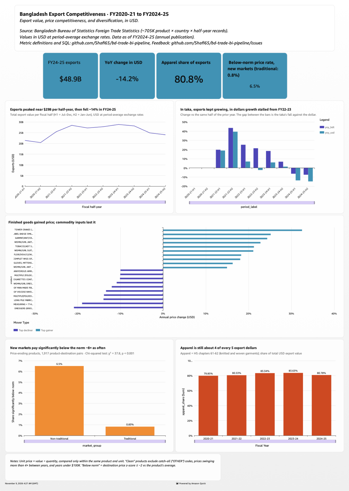

# Bangladesh Foreign Trade Analytics — AWS BI Pipeline

End-to-end BI pipeline analyzing Bangladesh's export prices and product diversification
(FY2020-21 → FY2024-25) from Bangladesh Bureau of Statistics trade publications.

**Status:** ongoing.

```
BBS PDFs/Excel → Python extraction → reconciliation gate → Parquet star schema
→ S3 → Glue Data Catalog → Athena (SQL views) → statistical tests / dashboard
```



## Setup

```bash
python3 -m venv .venv && ./.venv/bin/pip install -r requirements.txt
cp .env.example .env          # set ATHENA_BUCKET and ATHENA_WORKGROUP
```

Source publications go in `Bd_Exportdata/` (not included).

## Run

```bash
# 1. extract + reconcile
./.venv/bin/python ingestion/extract_fts_excel.py
./.venv/bin/python ingestion/extract_fts_pdf.py

# 2. build the star schema (Parquet)
./.venv/bin/python transform/build_warehouse.py

# 3. tests
./.venv/bin/python -m pytest

# 4. load to AWS + create tables and views
aws s3 sync data/processed s3://<bucket>/processed
./.venv/bin/python scripts/athena_run.py sql/create_external_tables.sql
./.venv/bin/python scripts/athena_run.py sql/analysis_views.sql

# 5. statistical tests
./.venv/bin/python analysis/stats_tests.py
```

## Layout

| Path | Contents |
|---|---|
| `ingestion/` | Excel/PDF extraction + reconciliation |
| `transform/` | Star schema build + QC |
| `sql/` | Glue DDL, Athena analysis views |
| `scripts/` | Athena runner |
| `analysis/` | Statistical tests |
| `tests/` | Parser and data-contract tests |
| `reference/` | FX rates, HS chapter names |
